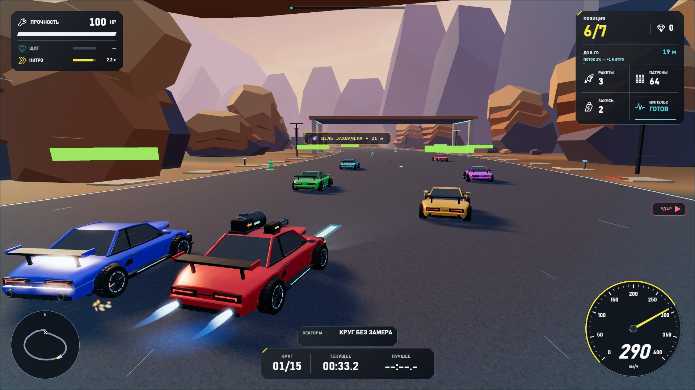
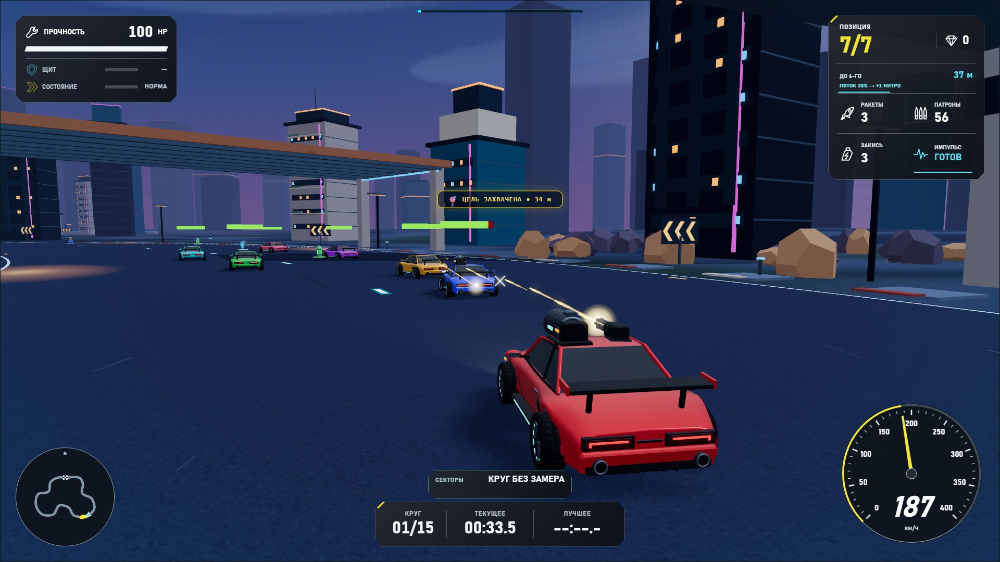
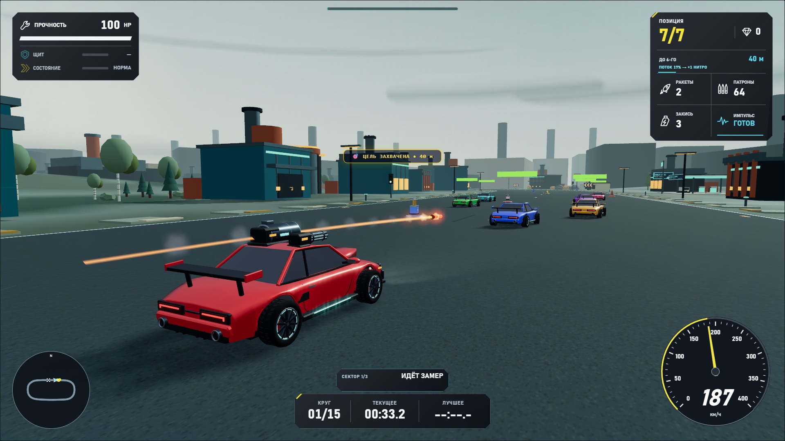
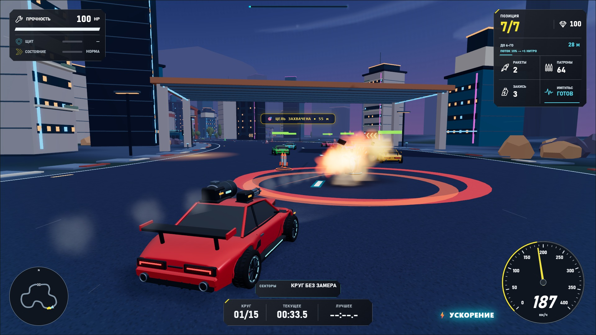
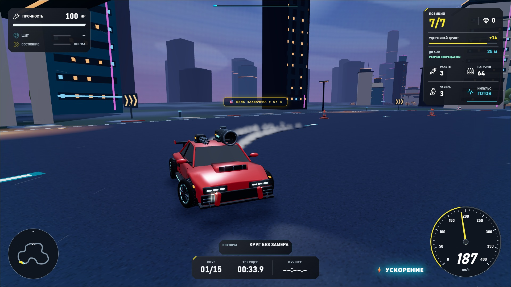

**Язык / Language:** [Русский](README.md) · **English**

# CYBER RACE: CAR WARS

CYBER RACE is a browser-based 3D combat racing game built with Three.js/WebGL. Choose a 1-lap Blitz, 3-lap Sprint or the original 15-lap Classic race against six AI opponents, using a machine gun, homing missiles, nitro and a defensive pulse. Seven cars start in two rows; opponents also fight each other.

**Precision defensive pulse:** the existing `Q` / gamepad `B` / on-screen shield button still intercepts hostile projectiles within 90 game units and disrupts nearby opponents (18-second cooldown). Incoming rocket alerts now distinguish preparation, a reachable intercept, a close-range precision window, and remaining cooldown. Intercept a **homing rocket aimed at your car** within 45 units to earn **one nitro charge**, at most once per pulse and subject to the existing five-charge cap. Ordinary bullets, missiles aimed at other drivers and interceptions from farther away do not give extra nitro. Credits, records and save formats are unchanged.

## Get started

**[Play online](https://dkoles.com/Games/cyber-race/index.html)** - no download or installation required.

Download https://github.com/zeter1/CYBER-RACE/archive/refs/heads/main.zip and extract the whole folder. Open `index.html` in a desktop browser. For predictable development behavior, run this command from the project folder:

```sh
python -m http.server 8000 --bind 127.0.0.1
```

Open http://127.0.0.1:8000. No build step or `npm install` is required. The game needs JavaScript and WebGL. Use a keyboard and mouse, a standard gamepad, or on-screen controls. On a phone, open the HTTP or HTTPS address. Three.js 0.160.0 is vendored locally, so an HTTP-served copy works without an internet connection; jsDelivr and unpkg remain fallback sources. Python is only needed for the optional server. Select the performance graphics mode on slower computers.

Before starting a solo race, choose Blitz (1 lap), Sprint (3 laps) or Classic (15 laps, default) in the start menu. All three modes use the same garage and upgrades but separate records. If an AI rival finishes first, your race continues until you finish; the results show your place from 1st to 7th. Finished rivals keep their crossing order, and unfinished rivals are ranked by distance at your finish. The victory bonus is paid only for first place; completed-lap credits are earned regardless of placing. Driving uses smooth acceleration and boost recovery, speed-sensitive steering and handbrake drifting. Clean forward overtakes without contact earn 30 score points, with a 12-second combo window up to ×3 (60/90 points). A **risky clean overtake** at a close but safe separation (8.5–18 world units near the pass) adds **20 score points** on top of the combo reward and shows its own notification; contact and dangerously close paths are excluded. Each rival pays at most once per current race. These are score points, not garage credits or championship standings points. After the first clean overtake, a compact chain indicator appears beneath the weapon HUD: current ×1–×3 combo, remaining gameplay seconds, the next reward, and a brief clean/risky-overtake notice. Pausing freezes its countdown; contact, destruction and restarting break the chain. Overtake notices no longer replace central race messages or combat warnings.

The six opponents share three personality profiles: racer, aggressor and tactician. They choose between racing, passing, lining up an attack and collecting useful pickups ahead along the road. Passing considers predicted nearby traffic, including the player; a blocked route causes slowing. Safe manoeuvres are held until completion or invalidation. Corner preview affects speed and nitro decisions; bots spend nitro for a safe tactical pass only after checking the full boost corridor, and active boosts prevent repeated spending.

Combat targets any racer based on range, facing, visibility, race progress and recent attacks. Opponents fire three-shot machine-gun bursts, conserve rockets against shields and check cover before firing. Shots can hit another racer in their path, excluding the shooter. Player scores, kills and combos only credit the player's own eliminations. Respawning opponents briefly resist damage and clear their target and burst.

## Game screenshots

### Nitro overtake in Neon Valley



### Machine-gun burst hits a rival



### A homing rocket in flight



### A rival car explodes after a rocket hit



### A smoky drift through the Neon Quarter



## Controls

| Action | Input |
|---|---|
| Drive | `WASD` / arrow keys |
| Machine gun / missile | Left / right mouse button |
| Handbrake / drift | `Shift` |
| Nitro / defensive pulse | `Space` / `Q` |
| Look behind (hold) | `C` |
| Restart (confirmation during an active race) / return to track | `R` / `T` |
| Full screen / sound toggle | `F` / `M` |
| Pause / menu | `Esc` |

Standard mapped gamepads: the left stick steers with a smooth deadzone, while the D-pad uses digital steering. RT applies **analog throttle (0–100%)**; LT applies **analog braking (0–100%)** and reverse. X fires the machine gun, Y fires a rocket, A uses nitro, B triggers the defensive pulse, LB engages the handbrake, **RB holds the rear glance**, and Start pauses/resumes. Keyboard or on-screen gas/brake input takes priority as full pressure over partial analog triggers. Coarse-pointer touch devices show on-screen driving, handbrake, shooting, boost, rear glance, shield and pause buttons during a race. On phones, a compact top strip shows health, position, lap, time and speed. The large steering arrows stay on the left, with Drift above them and brake below. Slide between the arrows to change direction. Larger buttons on the right show ammo and shield cooldown. Short tips and warnings share one strip, and the minimap stays centered. Enable Auto throttle (Автогаз) to steer and fire with two fingers. Race details and the return-to-track action are available from pause (10 points). Android and iPhone still need testing on real devices. Synthetic browser tests cover gamepad analog pressure; physical hardware still needs testing.

## Features and development

**Rear glance:** hold `C` (works with a Russian keyboard layout), the gamepad RB button or the on-screen **ОБЗОР** (View) button to see rivals behind the car. Release to immediately return to the normal chase camera. Steering, weapons and race progress are unaffected; pause clears the held view.

The race HUD includes a 0–400 km/h needle speedometer with an uncapped digital speed reading (including speeds above 400 km/h), minute/second lap timers, shield and boost countdown bars, an equipment grid and pulse-ready feedback. A live race-distance gap beside the position indicator shows how far you are from the next place ahead, or the runner-up when leading; a short trend describes whether the gap is closing or opening. If that rival has already finished, the HUD shows FINISH rather than an invented distance. The gap is measured along the route (including completed laps), not as a straight-line distance. The larger minimap shows the route, car heading, opponents and start/finish. Small windows use smaller instruments, icon-and-count equipment slots and fewer auxiliary labels. Nonessential HUD transitions respect reduced motion. Incoming-rocket and wrong-way warnings remain visible without flashing when reduced motion is enabled. Peripheral directional markers distinguish incoming missiles from hits or vehicle contact, showing the bearing relative to the car while keeping the road clear; reduced motion disables their transitions.


Each route has **three timing sectors**. A compact in-race indicator shows the last split and its delta versus your best previously completed sector **in this run**, using signed values and words as well as color. The finish screen displays all three splits from the last valid measured lap and identifies the largest time loss. Pausing freezes gameplay time; reversing, jumping to another part of the track, being destroyed or resetting to the road invalidates the current timing lap. On championship checkpoint resume, timing restarts with the next complete lap; sector timing data is not stored and does not change rewards or checkpoint schemas. A valid timing lap is now required to improve the best-lap record, so recovery, teleporting or driving backwards cannot write an artificially fast lap.

**Interactive pilot onboarding:** first-time players see three optional, action-based tips after the countdown: accelerate with throttle, actually fire a machine-gun shot, and successfully engage nitro. An additional one-time contextual reminder suggests the defensive pulse when a hostile rocket approaches and the pulse is ready. Prompts use gameplay time, disappear during pause, and adapt to keyboard/mouse, touch and standard-mapped gamepads. **Пропустить** (Skip) dismisses the three-step sequence; **Повторить инструктаж** (Replay tutorial) in the start/pause menus starts it again, and the **Инструктаж пилота** (Pilot tutorial) setting turns all tips off. Completion and the one-time reminder reuse the existing settings storage key, without modifying rewards, physics or championship saves.

**Persistent best-lap ghost:** after a fully valid lap, a translucent cyan car replays your fastest path on subsequent laps **and future races**, including one-lap Blitz. The best time and path are saved per track and car build, up to ten recent records, in the separate `cyberRaceLapGhostV1` browser storage key. Faster valid laps replace the matching record; slower, invalid and checkpoint-resumed incomplete laps do not. If storage is blocked, the ghost remains available in the current tab and the finish screen explains the limitation. A small “👻 ПРИЗРАК” indicator shows the best time and, on wide screens, an approximate signed advantage or delay relative to your saved path at the same location (“ВПЕРЕДИ ≈…” / “ПОЗАДИ ≈…”). A pace comparison is only displayed when moving forward near a similarly oriented part of that path; uncertain or distant matches show no delta. At widths up to 900px, only the best time is shown; very small viewports hide the badge. The ghost is visual only: no collisions, damage, weapons, AI changes or rewards. Toggle **Призрак круга** (Lap ghost) in start/pause settings using the existing preference key. Performance mode hides outlines, and the ghost vanishes after its recorded finish time.

The garage below Start fills the page with an illustrated workshop, three classes and six paints. Accessible hotspots over the artwork select cars and paint and buy upgrades; wallet, levels, prices and statistics are live text. Each unarmed car has three static podium views: front, side and rear. Body paint is recolored in code. In narrow windows, the garage scrolls vertically and keeps Close, Back and Apply available. Universal starts with 100 HP, Interceptor with 80 HP and Armored with 140 HP. Each class has its own purchasable engine, tire and armor levels 0–3. Engine gains +3% top speed and +7% acceleration per level (prices 400/800/1400 credits); tires improve road grip and steering response (300/600/1000); armor adds +15% max HP per level, rounded to an integer (350/700/1200). Stock level 0 is unchanged.

All classes share 1,200 starting credits. A real completed lap earns 300 credits. Classic victory adds 1,500; Sprint adds 300; Blitz adds 100. Without an optional contract, that is up to 6,000 credits for a winning Classic, 1,200 for Sprint or 400 for Blitz (400 per lap in each mode). Championship rewards are unchanged. Each award is granted once per race event. No selling, in-app payments or backend. Purchases persist **immediately**, even when Esc/Back cancels the draft class/paint selection; upgrades take effect only when the next race begins or restarts. The active build remains fixed during a race. The garage preview is a static illustration; the race uses separate procedural 3D models, with weapons visible when ammunition is available. Esc returns focus to the garage button. When browser storage is blocked, tuning and credits last only for the current tab, with a visible warning.

Current standalone-race records are isolated by **mode/track version** (Classic `valley-2026-v4`, Sprint `valley-2026-v4-sprint-3`, Blitz `valley-2026-v4-blitz-1`) and exact **build** (class + engine/tires/armor levels) under `cyberRaceTrackRecordsV1`. Historical `cyberRaceRecords`, `cyberRaceClassRecords` and `cyberRaceBuildRecords` are kept unchanged; times from earlier routes are kept under their original versions. Records use the active race build, not a pending purchase. Purchases/credits still use separate `cyberRaceTuning` storage. All records are per browser/origin. Failed record persistence is reported in the menu and at finish; the earned result remains in the current tab.

Optional driver contracts for standalone races: Hunter, Collector or Podium (top-three finish), or no contract. In one-lap Blitz, Hunter requires one kill and Collector two useful pickups; Sprint and Classic retain two kills and three useful pickups. The start menu and race HUD show targets for the selected mode. A completed contract pays 200 credits only once after the player's finish; championship points, checkpoints and saved data are unchanged.

The start menu uses a neon pit-stop layout with a start button, personal records, quick controls and race settings. “Все клавиши” opens the complete control reference; Esc closes it and returns keyboard focus. Starting is disabled while the game loads, and a loading error displays an explanation. Settings stay synchronized with the pause menu and are saved in the same browser storage. A failed or silently discarded save triggers a tab-only warning.

Pause uses the same pit-stop style, with a prominent resume button, compact controls/settings panels and separate restart/main-menu actions. Tab/Shift+Tab stay inside pause, and Esc resumes the race. Restart via R or the pause-menu button asks for confirmation during unfinished races; cancel keeps the current race intact and returns to the previous running/paused state. The post-finish replay is unchanged.

The bottom of both the main and pause menus contains an “Об игре” (About the game) section with a game description, developer Dmitry Kolesnichenko, dkoles.com, Telegram, email and a link to all contacts. Scroll down within the menu to see the entire section; website links open in a new tab.

Neon Valley runs past a pit pavilion, a sandstone arch and a canyon overlook under a warm sunset. Neon Quarter is a night race past mixed high-rise facades, a market hall, an elevated train and a canal. Steel Express has an overcast industrial skyline, a container terminal, workshops with amber-lit openings, cranes and cooling towers. Trackside shops, cafés, fuel stations, traffic signals and trees complement the larger landmarks. Cosmetic scenery animation respects pause and reduced motion.

Neon Valley is one circuit approximately 5,520 world units long and 80 units wide, with one approach to the finish. The player's car also collides with selected large roadside structures and can be returned to the track if stuck.

The cars have sculpted bodywork, open wheel arches, reflective glazing, alloy wheels, brakes and LED lights.

Pickups use six distinct rotating 3D models with recognizable shapes, different colors and glowing bases. Player and AI cars start unarmed. Rocket and ammunition pickups equip the matching weapons. Rockets, ammo and nitro accumulate without a gameplay cap. Repairs add 40 HP and can exceed starting health. Shield and speed pickups extend their remaining duration. After destruction, cars return to the start/finish line with starting health. They keep completed laps and collected ammunition, and start the current lap again.

**Tactical slipstream:** follow a live opponent for 1.4 seconds while moving forward on the road, staying roughly 18–105 game units behind in the same lane without contact, to earn one nitro charge (up to the existing cap of five). Each rival rewards only once per race; leaving the road, taking damage, losing the lane, or changing targets interrupts progress. The rival-distance HUD shows **ПОТОК** (draft) progress and the charge confirmation. Pause does not advance progress; credits, score, physics and AI are unchanged. The existing V1 championship checkpoint saves the IDs of already rewarded rivals, preventing repeat nitro grants after reload, while keeping the same storage key and compatibility with older saves.

Collect ammunition, missiles, nitro, health and shields; use drifting, damage and recovery mechanics while racing. **Drift mastery** rewards a sustained controlled slide on the road in the forward direction: hold a qualifying drift for at least 0.9 seconds, then release the handbrake to bank up to 90 score points per maneuver. Collisions, damage, going off-road or driving against the circuit cancel the pending score; the right-hand HUD previews progress and points. Pausing does not advance the timer. Drift mastery awards no credits.

Nitro sends blue-white flames out of the player's exhaust pipes. Drifting leaves smoke and tire marks on the asphalt and raises dust when a rear tire reaches the shoulder.

A close, centered chase camera keeps the car in the lower part of the screen and leaves the road ahead visible. It pulls back in narrow windows to fit the car. The field of view widens smoothly with speed, and nitro intensifies the peripheral airflow streaks. Reduced motion disables airflow, speed vibration and dynamic field of view.

Combat uses thin bullet tracers, muzzle flashes, continuous missile ribbons, expanding smoke, directed impact sparks, shield ripples, layered explosions, body fragments and scorch marks. Projectiles collide with selected solid scenery and with the ground when their path crosses it.

On touch screens, Auto graphics starts each race in Performance mode and raises quality after sustained fast frames. High graphics enables soft HDR bloom on compatible WebGL2 devices; performance mode reduces particles/debris and disables bloom. Camera shake respects its setting and reduced motion. Custom synthesized sound effects combine with a revving engine, audible gear changes, road noise, tire skid and nitro. Combat uses distance attenuation and stereo direction, with compression on the overall mix; direct file launches or unavailable samples use procedural fallback. See [audio sources and licenses](docs/AUDIO_ASSETS.md).

For development, start with [AGENTS.md](AGENTS.md), then use the [code map](docs/CODE_MAP.md), [architecture](docs/ARCHITECTURE.md), [development guide](docs/DEVELOPMENT.md), [verification commands and scenarios](docs/VERIFICATION.md) and [change history](CHANGELOG.md). These detailed documents are in Russian. Local checks need Node.js; CI uses Node.js 24. Markdown-only changes trigger the current validation workflow; the local links checker covers the documentation tracked by that workflow.

Automated checks and scenario contracts do not replace interactive WebGL gameplay testing. Use a separate test browser context to keep your own settings and records intact. The pinned, MIT-licensed Three.js distribution is included under `vendor/three/` and verified by SHA-256. For offline use, serve the extracted directory over local HTTP; direct `file://` use can restrict ES module imports.

## Support and security

Open https://github.com/zeter1/CYBER-RACE/issues for problems. Include browser/version, graphics settings, exact steps, expected and actual results, and a short console excerpt without secrets. Use [SECURITY.md](SECURITY.md) for vulnerability disclosure.

## Developer contacts

- [zeter11@gmail.com](mailto:zeter11@gmail.com)
- [https://t.me/zeter1](https://t.me/zeter1)
- [https://www.linkedin.com/in/zeter/](https://www.linkedin.com/in/zeter/)
- [https://www.facebook.com/zeter1](https://www.facebook.com/zeter1)
- [https://vk.ru/zeter1](https://vk.ru/zeter1)
- [https://www.instagram.com/zeter1992/](https://www.instagram.com/zeter1992/)
- [https://tenchat.ru/zeter](https://tenchat.ru/zeter)
- [https://x.com/zeter1](https://x.com/zeter1)
- [https://www.threads.com/@zeter1992](https://www.threads.com/@zeter1992)
- [https://ok.ru/zeter1](https://ok.ru/zeter1)
- [https://t.me/zeterchat](https://t.me/zeterchat) — Telegram group: about me, projects and chat

## Championship

Choose “Начать чемпионат” in the main menu for three stages: Neon Valley (3 laps), Neon Quarter (4 laps) and Steel Express (5 laps). The city circuit has its own winding geometry and city buildings; the industrial circuit has long straights and industrial scenery. The regular Start button still runs the original 15-lap race. Championship difficulty is fixed when a new championship starts; later setting changes apply to regular races and the next new championship.

Seven stable driver identities earn 15 / 12 / 10 / 8 / 6 / 4 / 2 points by position. A leading opponent finishing does not end a championship stage: finish your own race. Finished opponents retain their finish order; the remaining opponents are classified by distance at your finish. Total-points ties use wins, then the most recent stage position. Results show both the stage and overall standings.

“К зачёту и гаражу” returns to the menu after a stage. Visit the garage to spend the shared credits, then start the next stage. The selected build takes effect at stage start. Championship races do not write regular lap/time/score records.

Championship standings save at the start and after every completed stage. A separate `cyberRaceStageCheckpointV1` records the unfinished stage about every 5 seconds, when pausing or leaving, and on unload. In the same browser and origin, Continue restores the car, lap, resources, six rivals and remaining pickups if the checkpoint matches the championship, stage, route version and active build. An unfinished Neon Valley stage from the previous route restarts on the updated route. In-flight projectiles and temporary visual effects do not survive the reload; a short starting countdown precedes resumed control. Manual stage restart clears the checkpoint. If browser storage refuses writes, a reload can still restart the stage; the previous completed stages and garage are independent. Starting a new championship replaces the prior standings after confirmation and keeps the garage and historical records.
